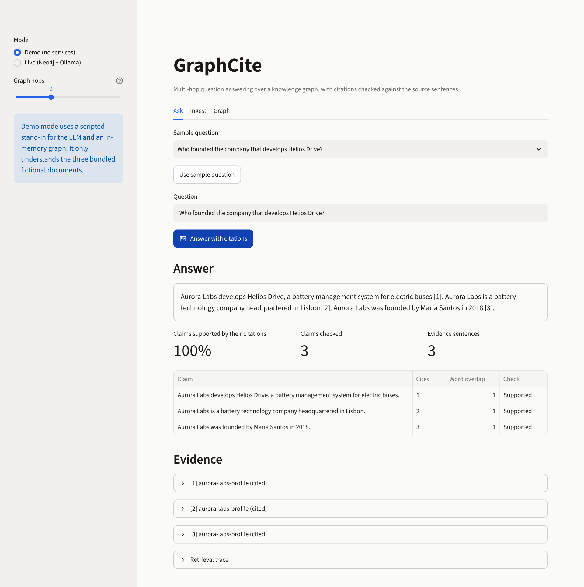
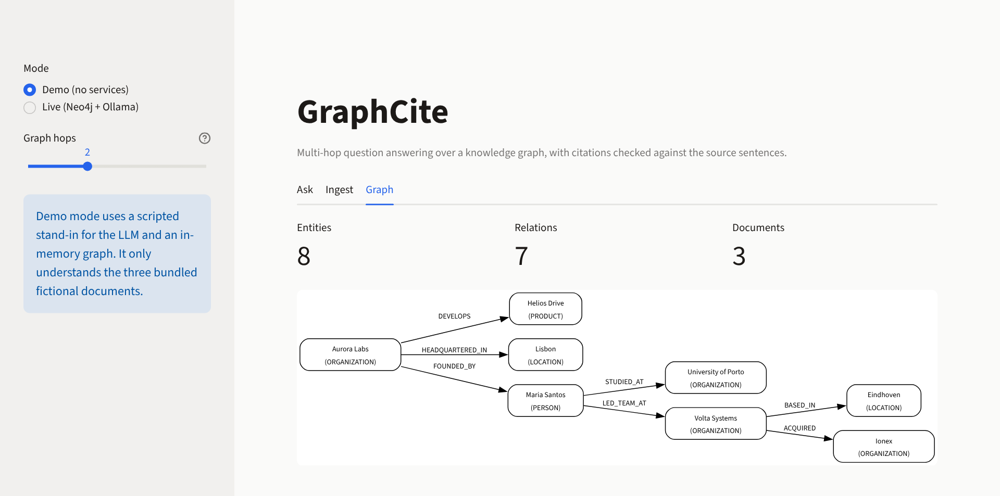
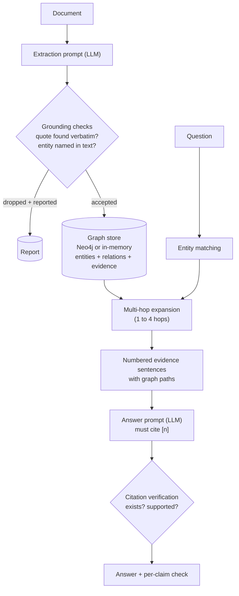

# GraphCite

[](https://github.com/madhur0770/GraphCite/actions/workflows/ci.yml)

**Multi-hop question answering over a knowledge graph, with citations that are checked against the source sentences instead of trusted.**

GraphCite turns documents into a knowledge graph (Neo4j), answers questions by walking the graph across documents, and then verifies the answer: every statement must cite numbered evidence, and each citation is checked for existence and for word-level support in the cited sentence. Uncited, mis-numbered and unsupported statements are flagged in the UI.

Project page: <https://madhur0770.github.io/GraphCite/>



*Demo mode: a two-hop question answered with every claim checked against its cited source sentence.*



*The graph GraphCite builds from the bundled fictional demo documents (rendered from `scripts/graph_to_mermaid.py` output).*

## Why graph retrieval

Chunk-based vector search finds passages that look like the question, but struggles when the answer spans documents: *"Which company did the founder of Aurora Labs work for before, and what did that company acquire?"* needs a chain across three documents (Aurora Labs, its founder, her previous employer, what it acquired). GraphCite merges entities across documents and expands from the entities named in the question, so each hop carries its own source sentence.

## What makes the citations verifiable

1. **Grounded extraction.** The model must quote the sentence supporting every entity and relation. Anything whose quote is not found verbatim in the document, or whose entity name does not occur in it, is dropped and reported.
2. **Provenance on every edge.** Relations store the document and sentence they came from. Entities merge across documents by normalised name, accumulating evidence.
3. **Post-hoc verification.** For each sentence of the answer: does it cite anything, do the cited numbers exist, and do the cited sentences contain its content words? The overlap score is real (word containment), not a constant.

Limits of the check: it is lexical. It catches uncited, mis-numbered and unsupported statements; it cannot judge paraphrase or logical entailment, and extraction does not resolve pronouns across sentences.

## Try it now (no services, no model)

```bash
git clone https://github.com/madhur0770/GraphCite.git
cd GraphCite
python -m graphcite.demo                 # standard library only
pip install -r requirements.txt
streamlit run app.py                     # Demo mode is the default
```

Demo mode uses a **scripted stand-in for the LLM** and an in-memory graph, and only understands the three bundled fictional documents. It exercises the real extraction validation, graph store, retrieval and citation verification. Output of `python -m graphcite.demo` for the first sample question:

```text
==============================================================================
Q: Who founded the company that develops Helios Drive?   (hops: 2)
  - Matched entities: Helios Drive (1.00)
  - Collected 3 evidence sentence(s) within 2 hop(s).
  - Verified 3 claim(s): 3 supported, 0 weak, 0 uncited or mis-cited.

A: Aurora Labs develops Helios Drive, a battery management system for electric buses [1]. Aurora Labs is a battery technology company headquartered in Lisbon [2]. Aurora Labs was founded by Maria Santos in 2018 [3].
  [supported       ] cites 1   overlap 1.00  Aurora Labs develops Helios Drive, a battery management system for ele
  [supported       ] cites 2   overlap 1.00  Aurora Labs is a battery technology company headquartered in Lisbon.
  [supported       ] cites 3   overlap 1.00  Aurora Labs was founded by Maria Santos in 2018.
  [1] aurora-labs-profile: "Aurora Labs develops Helios Drive, a battery management system for electric buses."
      path: Aurora Labs -[DEVELOPS]-> Helios Drive
  [2] aurora-labs-profile: "Aurora Labs is a battery technology company headquartered in Lisbon."
      path: Aurora Labs -[DEVELOPS]-> Helios Drive | Aurora Labs -[HEADQUARTERED_IN]-> Lisbon
  [3] aurora-labs-profile: "Aurora Labs was founded by Maria Santos in 2018."
      path: Aurora Labs -[DEVELOPS]-> Helios Drive | Aurora Labs -[FOUNDED_BY]-> Maria Santos
```

## Live mode: Neo4j + Ollama

```bash
cp .env.example .env            # set NEO4J_PASSWORD (8+ characters)
docker compose up --build       # app + Neo4j; uses Ollama on your host
# or: docker compose --profile ollama up --build   (also starts an Ollama container)
ollama pull llama3.2
```

Open <http://localhost:8501>, choose **Live (Neo4j + Ollama)**, paste a document on the **Ingest** tab and ask questions. Without Docker, run Neo4j 5 yourself and set `NEO4J_URI`, `NEO4J_USER`, `NEO4J_PASSWORD`, `OLLAMA_HOST` and `GRAPHCITE_MODEL`.

## Architecture



Details: [docs/architecture.md](docs/architecture.md).

## Testing

```bash
python -m unittest discover -s tests -v       # 67 tests; Neo4j and UI tests are skipped when unavailable
pip install -r requirements.txt pyyaml        # to include the Streamlit UI tests
NEO4J_URI=bolt://localhost:7687 NEO4J_USER=neo4j NEO4J_PASSWORD=... python -m unittest tests.test_store -v
```

The store contract tests (idempotent upserts, cross-document evidence merge, hop limits, direction, cycle handling, depth validation) run against both the in-memory store and a real Neo4j. CI runs the suite on Ubuntu and Windows (Python 3.11 and 3.12), runs the contract tests against a Neo4j service container, runs the Streamlit UI tests (`AppTest`), validates `docker-compose.yml` and builds the image.

Not covered by automated tests: the Ollama path (needs a local model) and answer quality with a real model.

## Configuration

| Variable | Default | Purpose |
|---|---|---|
| `NEO4J_URI` | `bolt://localhost:7687` | Neo4j connection |
| `NEO4J_USER` | `neo4j` | Neo4j user |
| `NEO4J_PASSWORD` | none | Neo4j password (required by Compose) |
| `OLLAMA_HOST` | `http://localhost:11434` | Ollama server |
| `GRAPHCITE_MODEL` | `llama3.2` | Ollama model name |

## Security notes

- Compose requires a password from `.env` (git-ignored), pins Neo4j, and publishes ports on `127.0.0.1` only.
- GraphCite only reads, writes and deletes nodes labelled `Entity`. The Clear button needs an explicit confirmation.
- Documents you ingest are sent to your local Ollama server only; nothing is sent to third-party APIs.

## Limitations

- Entity matching is lexical (name words in the question); no embeddings, aliases or coreference resolution yet.
- Matching loads entity names into memory, which is fine for thousands of entities but not millions.
- Answer quality in live mode depends on the local model; small models may ignore the citation format, which the verifier then flags.
- Live check performed with Ollama `llama3.2` on the bundled demo documents: the two-hop sample question was answered correctly and both claims verified (word overlap 0.88 and 1.00). Fact extraction varied between runs with this small model, sometimes yielding fewer facts, in which case a question can find nothing to answer from. A larger model was not tested.

## Project structure

```text
app.py                 Streamlit UI (demo and live modes)
graphcite/             models, text utilities, extraction, store, retrieval, answer verification, pipeline, demo data
tests/                 67 tests (store contract, extraction, verification, pipeline, UI, hygiene)
scripts/               Graph-to-Mermaid helper
docker-compose.yml     App + Neo4j (+ optional Ollama)
Dockerfile             Non-root Streamlit image
docs/                  Architecture notes and project page
```

## Future improvements

- Embedding-assisted entity matching and aliases.
- Entailment-based claim checking.
- Pronoun/coreference handling before extraction.

## Author

Madhur Kumar Rana
